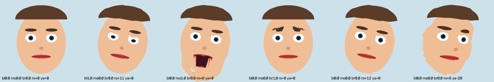

# Face AI evidence (2026-11-08, D295 proposed)

Design: `docs/plan/2026-11-08-face-ai-design.md`. Branch `ai/face`. Flag `face-ai` off by default. No camera was
opened: every test uses synthetic frames, a fake worker or a generated test video. No real face is in any committed
file; the avatar strip below shows a generated cartoon.

Machine: RTX 4050 Laptop 6 GB, Windows 11, Python 3.14.7 in `.venv-gpu` (onnxruntime-directml 1.24.4, numpy, opencv).
Noise during the bench: two Qt studios from other worktrees were open (about 35% GPU, 1.4 GB VRAM at idle). No
ujwalam-host, OBS or Meld Studio was live or recording (checked before the run).

## Tests

| Check | Command | Result |
|---|---|---|
| Python unit tests (mask curve, guided upsample, smoother, One Euro, autoFrame, sticker, features, link layout, avatar warp/triangulation/TPS) | `npm run test:face` (`.venv-gpu`, `-I`) | 16 pass (all skip on a Python without numpy) |
| Host face tests: parse and bad values; `face.status` with no worker; personMask remove/replace/blur with a synthetic mask from a fake worker, stale fade; autoFrame crop to a yellow quadrant; faceSticker at the eye midpoint, hidden when stale | `node --test app/host/tests/host-face.test.mjs` | 4/4 pass (about 49 s) |
| Project schema + validator cases | `node --test tests/project-schema.test.mjs` | 108 pass |
| Registry | `npm run validate-registry` | valid (camera-background-effects 0.2.0, camera-auto-frame, camera-face-sticker, camera-face-avatar planned; 4 presets) |
| Lint | `npm run lint` | 0 findings |
| Qt build + shell | `node --test tests/studio-qt-shell.test.mjs` | 19/19 pass |
| Full unit run | `npm test` | 1427/1430 pass. 2 failures not from this work: `ci.test` "build step recompiles a touched source" (the `app/spike/build` junction points into the main tree, so the worktree cannot touch its own build); a soak-system timing flake that passes alone. 1 skip (opt-in bench) |
| Bench | `UJWALAM_FACE_BENCH=1 node --test app/host/tests/host-face-bench.test.mjs` | 1/1 pass (190 s) |

## Bench: face AI next to a 1080p60 NVENC recording

Scene: 1920x1080 at 60 fps. A looping 1280x720 test video (ffmpeg `testsrc2`, no face) shown with personMask blur,
plus a duplicate with autoFrame. Recording: NVENC H.264 CBR 17 Mbps 1080p60 to a local file. The real face worker
runs on `.venv-gpu` with the flag on in a temporary data dir only. Samples cover 10 s per phase (4 s after the worker).

| Phase | Host frame ms | fps | Lagged/rendered | Enc skipped/encoded | GPU % | NVENC % | VRAM used MB | Results/s | Worker infer ms | Latency ms |
|---|---|---|---|---|---|---|---|---|---|---|
| idle | 0.236 | 60.0 | 0/604 | 0/0 | 35 | 0 | 1444 | 0 | - | - |
| recording | 0.342 | 60.0 | 0/633 | 0/633 | 33 | 39 | 1590 | 0 | - | - |
| recording + face worker | 0.493 | 60.0 | 0/601 | 0/601 | 39 | 39 | 1662 | 29.4 | 14.77 | 50.0 |
| after worker killed | 0.343 | 60.0 | 0/268 | 0/268 | 32 | 39 | 1592 | 0 | (last) | (last) |

Read: the worker adds about 0.15 ms host frame time, about 72 MB VRAM and about 5 points of GPU. Nothing lagged and
no frame was skipped by the encoder. Results arrive at 29.4/s (the 30/s cap). Latency is from the host rendering a
frame to the result being back in the host: 50 ms (about 3 frames at 60 fps). This includes the 2-tick readback.
Worker infer is 14.8 ms for segmentation + tracker. The test video has no face, so YuNet detection runs on every frame.
With a face present, the mesh tracks from the previous frame (UNVERIFIED on real footage). Killing the worker brings
host cost and VRAM back to the recording baseline. The layers then draw plainly.

## Per model, while the recording runs (tools/bench/face_ai_bench.py, 300 frames each, 30 fps pacing)

| Model | Input | Provider | Load ms | VRAM MB | Infer ms (p95) | CPU % | GPU % | NVENC % |
|---|---|---|---|---|---|---|---|---|
| selfie-landscape (default) | 720p | DirectML | 293 | 61.6 | 5.15 (7.13) | 17.2 | 28.7 | 34.9 |
| selfie-landscape (default) | 1080p | DirectML | 300 | 64.4 | 4.17 (5.64) | 21.9 | 26.7 | 33.8 |
| selfie-square | 720p | DirectML | 283 | 58.2 | 7.21 (9.52) | 25.3 | 29.3 | 34.0 |
| selfie-square | 1080p | DirectML | 310 | 53.7 | 5.31 (7.86) | 27.8 | 28.8 | 34.7 |
| modnet-fp16 | 720p | DirectML | 334 | 172.6 | 16.61 (18.51) | 52.3 | 38.2 | 19.5 |
| modnet-fp16 | 1080p | DirectML | 320 | 172.6 | 16.43 (18.35) | 59.1 | 37.8 | 19.6 |
| rvm-mobilenetv3 | 720p | DirectML | 329 | 113.8 | 12.40 (15.47) | 40.5 | 30.0 | 32.1 |
| rvm-mobilenetv3 | 1080p | DirectML | 340 | 113.8 | 13.63 (15.46) | 48.6 | 31.4 | 32.9 |
| face tracker (YuNet + mesh 468, default) | 720p | CPU | 312 | 13.6 | 2.48 (2.82) | 13.4 | 25.3 | 33.8 |
| face tracker (YuNet + mesh 468, default) | 1080p | CPU | 315 | 13.6 | 2.54 (2.84) | 20.6 | 24.5 | 33.3 |

- Input is downscaled to the model size first, so 1080p costs about the same as 720p.
- CPU % is the whole worker process, 100% = one core.
- VRAM is the device change measured by nvidia-smi.
- DirectML refuses the face mesh graph ("The parameter is incorrect"), so the tracker runs on CPU by the per-model
  fallback.
- MODNet drops NVENC utilisation to about 19%. The recording's encode counters were not sampled during this part,
  so UNVERIFIED whether frames were skipped. This is one more reason MODNet is not a default.

## Avatar prototype (approach A, offline)

`python -I services/face/avatar.py` drives the generated cartoon reference (19 anchors, thin-plate spline to the 468
mesh) with a 6 s synthetic expression sequence (blink, mouth, brows, roll, yaw). Result: 180 frames at 512x512,
908 triangles, about 61 to 75 ms per frame on CPU. Output stays in the gitignored `data/models/face/test/`.

The strip shows neutral, blink + roll, mouth open, brows up, roll, and yaw. Visible limits: the jaw edge tears on a
wide-open mouth, brows tear when raised, and eye whites stretch on roll and yaw. It is not live-ready.

## Review fixes (2026-11-08, second-opinion security review)

Branch `ai/face-fix`. A second model family (Codex) reviewed the face AI feature; each finding was checked against
the code. Link layout is now version 2 (host and worker must match; an old worker is refused).

| # | Finding | Result | Fix |
|---|---|---|---|
| 1 | Models used without a SHA-256 check | fixed | `face_models.verified_bytes`: every file a model needs (the .onnx and the face mesh's external `.data`) is read once, size and SHA-256 checked against `data/models/face-ai.json`, and those bytes are what loads: `ort.InferenceSession(bytes)` with `add_external_initializers_from_files_in_memory` for the `.data`, and YuNet through the buffer overload of `cv2.FaceDetectorYN.create`. No path reaches onnxruntime or OpenCV, so a file swapped after the check is never run. Mismatch: `ModelIntegrityError`, nothing loads |
| 2 | Shared-memory floats trusted by the renderer | fixed | `face::validate`: exact landmark count (0 or 468, consistent with the found flag), every landmark and box value finite and in bounds, box size > 0, roll/yaw/pitch/features in their ranges, inference time finite, mask size equal to the size of the frame it answers. A failing result is dropped whole. `faceSticker` checks width/height/position finite and 1 to 16384 px right before the `uint32_t` conversion; `autoFrame` clamps the face centre and skips non-finite values |
| 3 | No interprocess ordering on the writer | fixed | Result publish: lock odd, full barrier, payload, full barrier, lock even. Python has no exported Interlocked call on x64, so the barrier is `FlushProcessWriteBuffers` (documented process-wide memory barrier); the worker refuses to open the link on anything but x86-64. Host reads the lock with an acquire load and an acquire fence before the re-check; a snapshot taken during a write is skipped, never waited for |
| 4 | Result seq read outside the snapshot | fixed | The result seq is read after the even lock and judged only when the final lock matches |
| 5 | Weak freshness and provenance | fixed | Host ring of the last 32 published frames (seq, generation, steady-clock capture time, size). A result is used only for a seq in the ring, newer than the last used, of the current generation. Freshness and latency use the host's own capture time; the worker's timestamp is only echoed. Heartbeat checks compare without subtracting the worker's value (no overflow) and refuse heartbeats more than 1 s in the future (both sides) |
| 6 | `mask=None` kept the old mask fresh | fixed | Mask valid flag + mask seq in the result block. The host uploads and refreshes the mask only for a new valid mask; results without one let the old mask age out |
| 7 | Temporal state survives camera changes | fixed | Host target generation (new on every target change, also when a target idles out), written with each frame, echoed in each result; results of another generation are refused. The worker resets mask EMA, One Euro, the tracker's previous mesh and the recurrent matte when the generation changes |
| 8 | Worker does not authenticate the mapping | fixed | Per-launch 32-byte link key. Launcher: to the host by environment (`UJWALAM_FACE_LINK_KEY`, the existing pattern for host secrets: read, validated and removed from the host's environment at start, never logged or written to the discovery file); to the worker as a JSON line on its stdin pipe (the existing parent pipe, D234), again after every host restart with the new pid. The host writes it into the header; the worker opens a mapping only when the key matches (constant-time) and the mapping's owner SID is its own user (or token owner). A host started without a key generates a random one (no worker can attach) |
| 9 | Worker inherits the parent environment | fixed | `faceEnv` is an allowlist (`FACE_ENV_ALLOW`: PATH, PATHEXT, SYSTEMROOT, SYSTEMDRIVE, WINDIR, TEMP, TMP, USERPROFILE, LOCALAPPDATA, APPDATA, PROGRAMDATA, PROGRAMFILES, processor/OS vars, UJWALAM_HEADLESS) plus the parent-pipe marker. The worker no longer reads the discovery file at all: it held host tokens whenever the host generated them (the host system token under the launcher), and the worker needs only the pid, which now comes on stdin. Network restriction: not done (residual, below) |
| 10 | Download not capped | fixed | `copy_capped`: downloads and zip members stop as soon as they would pass the manifest size (also refused up front when `Content-Length` or the zip header says more), partial files deleted |
| 11 | `gs_stagesurface_map` can wait for the GPU | fixed | A D3D11 event query is issued right after each staging copy; a surface is mapped only once `GetData` reports the copy done, otherwise it stays pending (dropped after 30 ticks). 4 staging surfaces; with all busy no new frame is staged. Non-D3D11 renderers keep the old 2-tick delay. `face.status.readback` reports maps, not-ready ticks, drops, max and average map+copy time |

Nothing was rejected. Finding 3 is fixed with a barrier other than the one the reviewer suggested
(`InterlockedExchange` is not exported from kernel32 on x64, so ctypes cannot call it).

### Tests (2026-11-08, this branch)

| Check | Command | Result |
|---|---|---|
| Python face tests: SHA rejection (onnx, external .data, longer file, missing), onnxruntime session from verified bytes with in-memory external data (a hand-written 1-node ONNX graph), YuNet built from verified bytes and refused when tampered, link key (right, wrong, old version, none), a squatted named mapping with another key refused, mask valid flag and mask seq, generation in frames, future host heartbeat refused, control lines, stdin key + EOF, generation reset and echo through `serve`, reopen after a host restart, download cap (endless stream, announced length, exact file, zip member, partial file deleted); plus the earlier 16 | `npm run test:face` (`.venv-gpu`, `-I`) | 34 pass |
| Host face tests: the earlier 4, plus wrong key never attaches; NaN, Inf, 1e30, 400 landmarks, feature out of range refused (and NaN renders the plain layer: no crop, no sticker); unsent seq and wrong generation refused; a new target gets a new generation; a future worker timestamp does not keep the mask fresh; results without a mask let the old mask age out; churning result lock: torn snapshots counted, none used | `node --test app/host/tests/host-face.test.mjs` | 11/11 pass |
| Launcher: face env allowlist, control line format, real worker takes the key on stdin and exits when the pipe closes (key never logged) | `node --test tests/studio-ui-alpha.test.mjs` | 33/33 pass |
| Schema tests | `node --test tests/project-schema.test.mjs tests/g0-schemas.test.mjs` | 133 pass |
| Registry | `npm run validate:registry` | valid |
| Lint | `npm run lint` | 0 findings |
| Host build | `node app/host/tools/build.mjs` | builds, no warnings in the changed files |

Readback with the fake worker (host face test, 1280x720 at 30 fps scene, 320x180 camera layer, NVENC 720p
recording in parallel; another worktree's host test was running at the same time): 125 maps, 0 not-ready ticks,
0 dropped, map + copy max 0.094 ms, average 0.031 ms. The copy was always done by the next tick, so the map never
waited.

### Residual and UNVERIFIED (review fixes)

- UNVERIFIED: the real models through the new loaders. `data/models/face/` was not present on this machine (the
  models were in the removed `ai/face` worktree) and nothing was downloaded. The loaders are proven with
  hand-written ONNX graphs (onnxruntime with in-memory external data; the YuNet buffer overload); a run with the real
  selfie, YuNet and face mesh files is still to do (`python -I services/face/fetch_models.py`, then
  `npm run test:face` and the bench).
- UNVERIFIED: the full bench (`UJWALAM_FACE_BENCH=1`, host frame time with the real worker next to NVENC) was not
  re-run: it needs the models. The bench test now passes the link key like the launcher.
- UNVERIFIED: the owner check against a mapping owned by another user (making one needs another account or
  SeRestorePrivilege). The positive case and the key check are tested.
- Residual: the worker process has network access (no per-process firewall rule; it opens no socket in its code).
  Out of scope for this fix.
- Residual: any process of the same user can open the owner-only mapping and read the key or frames; that is the
  same trust boundary as the host's own tokens.

## Flaky host face test fixed (2026-11-08, branch fix/face-flaky)

`app/host/tests/host-face.test.mjs` failed 2 of 6 runs (different tests: freshness, mask valid flag, bad values).
Failure signature: the fake worker saw 1 frame in 2.5 s (the old frame still in the link), `framesSent` did not move,
and that one result was refused as "previous target".

Cause: a host bug in `app/host/src/face.cpp`, not test timing. The link kept its target camera as a weak reference
plus a raw pointer used for identity. After a `project.load` the old camera source is destroyed, but the link only
dropped it after the 1 s idle-out. If libobs allocated the new camera at the freed address, `use()` saw the "same"
pointer: no new target and no new generation, and the weak reference never resolved again, so no frame was captured
for as long as the layer stayed on screen (stuck, not just late). The new camera could also inherit the old target's
mask and face for the hold time.

Fix: `use()` and the tick drop a target whose weak reference has expired (`obs_weak_source_expired`) before any pointer
compare. While the weak reference is alive the old source is still allocated, so no live source can share its address.
A side effect: a project switch now settles on the new camera in about one frame instead of after 1 s.

Tests: every test that loads a project and then starts a worker waits for the settled target first (`loadSettled`:
new generation and a target set, polled from `face.status`); the waits before recording poll the result counters
instead of fixed sleeps; assertion messages print the counter deltas, target, generation and last reject. New
regression test: 20 alternating loads must each settle within 500 ms.

| Check | Command | Result |
|---|---|---|
| Probe, unfixed host: 80 alternating loads (two projects, face effect on different image layers) | scratch script, `face.status` after each load | 1 stuck (target name and generation of the old camera after 2.5 s); the other 79 settled only after the idle-out (median 1030 ms) |
| Probe, fixed host: 200 alternating loads | same | 0 stuck; settle median 22 ms, max 47 ms |
| Regression test on the unfixed host | `node --test --test-name-pattern="destroyed target" app/host/tests/host-face.test.mjs` | fails: `load 1: new target: not reached in 500 ms` |
| Unfixed host, test file alone (diagnostics only) | `node --test app/host/tests/host-face.test.mjs` x6 | 6/6 pass (the flake did not show on an idle machine) |
| Fixed host, test file alone | `node --test app/host/tests/host-face.test.mjs` x15 | 15/15 runs pass (12/12 tests each, about 90 s per run) |
| Fixed host, alongside the rest of the host suite | `npm run test:host` x3 | 3/3 runs pass (132 tests: 130 pass, 0 fail, 2 opt-in skips; concurrency 2; all 12 face tests passed in each run) |

## UNVERIFIED

- Mask quality, tracking stability and feature ratios (blink, mouth, brows) on the real facecam and real lighting.
- Latency and host cost with a real camera source plus game capture (the bench used a media file and no game).
- MODNet weights licence (the code licence is Apache-2.0).
- Qt studio runtime UX for the new effect rows (the build and shell test pass; no hand check).
- LivePortrait figures in the design doc (recalled, not checked).

## Camera test steps (for the user; needs a yes, not run)

1. Close any stream or recording. Turn on `face-ai` on the control page (or put `{"flags":{"face-ai":true}}` in
   `<data dir>/flags.local.json`). Start Ujwalam as usual; the face worker starts with it.
2. On the facecam layer, add the preset "Blur background", then "Remove background". Check hair edges, hands and
   the chair. Tune "Edge softness" and "Steadiness".
3. Add "Camera follows face" on a duplicate of the facecam. Move left and right, then leave the frame for 2 s.
4. Add "Sticker on eyes" with any PNG with a transparent background. Tilt your head.
5. Read the host method `face.status` (latencyMs, inferMs) (no UI shows it yet), and note the frame time with the game running.
6. Turn the flag off: the layers must go back to the plain camera within a second.
